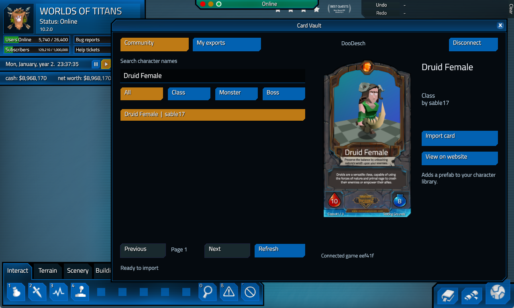
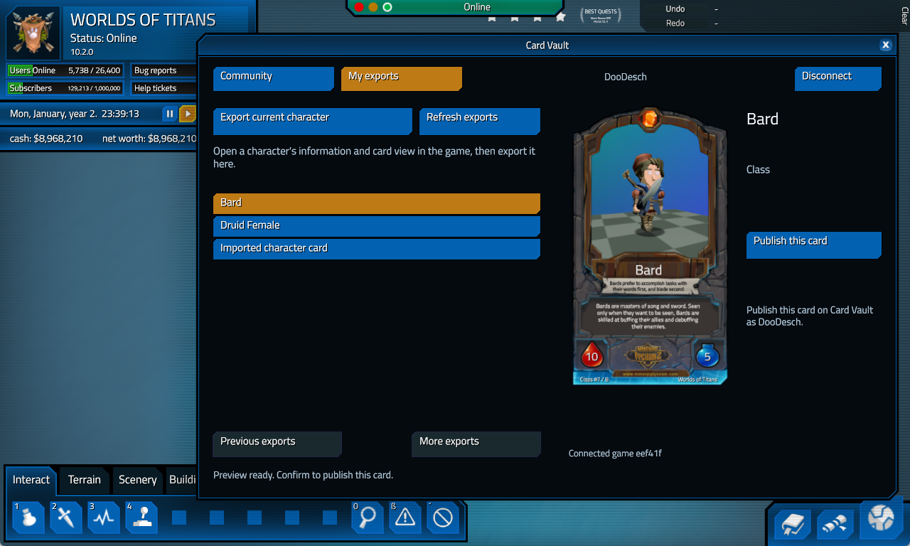

# MT2 Card Vault

> 🛟 **Need help or found a bug?** Get support at [support.doodesch.de/cardvault](https://support.doodesch.de/cardvault).

Find your next character without leaving the game. Browse community cards, add them to your character library and share your own creations on [Card Vault](https://mmorpgtycoon2cardvault.vercel.app).



**[Download](https://github.com/DooDesch-Mods/MMORPGTycoon2-CardVault/releases)** | **[Card Vault website](https://mmorpgtycoon2cardvault.vercel.app)** | **[Changelog](CHANGELOG.md)**

## Requirements

- Windows x64 and the supported Steam build of MMORPG Tycoon 2.
- [MT2 Mod Framework 0.1.4 or newer](https://www.nexusmods.com/mmorpgtycoon2/mods/25).
- An internet connection and a Discord account to connect Card Vault.
- A game window of at least 1280 x 768 for the Card Vault interface.

This version supports singleplayer. Game updates can require an adapter update; the [framework compatibility page](https://github.com/DooDesch-Mods/MMORPGTycoon2-ModFramework/blob/main/docs/compatibility.md) lists the supported build. Native plugins require a restart after an update.

## Install

1. Close the game. Install the framework runtime and the [MMORPG Tycoon 2 Vortex Extension](https://www.nexusmods.com/site/mods/2465).
2. Import the Card Vault ZIP into Vortex, enable it and deploy.
3. Start the game through Steam. Choose **Mods...**, select **MT2 Card Vault**, then **Open Card Vault**. At the title screen, use the **Mods** desktop icon.
4. Choose **Connect with Discord**. Sign in on the website, compare the connection code and approve your game.

For manual installation, extract the ZIP's `doodesch.cardvault` folder into `<profile>/mods/`. Use the profile path configured in `mt2fw.json` beside the game executable. The SDK helper can also install the mod ZIP.


## Find and import a card

Search by name or filter by **Class**, **Monster** or **Boss**. Select a card to see its artwork, then choose **Import card**. It appears in the game's **Prefabs** list with a readable filename. Importing a card adds a prefab; it does not replace a character already in your world. Use the game's own prefab controls to apply it.

While your game is connected and running, card pages on the website also show **Import in game**. The page confirms the import after the game has received the card and refreshed its library. If you have multiple connected games, select the intended connection first.

## Share your own character

1. Open a character's information view and its card in the game.
2. In Card Vault, open **My exports** and choose **Export current character**.
3. Check the artwork and card details, then choose **Publish this card**.

Publishing makes the card public under your Card Vault account. You can manage it on the website under **My cards**. You can also preview and publish existing character PNG exports from the current profile.



## Connection and troubleshooting

The game receives a revocable Card Vault connection, valid for 14 days. Discord sign-in stays in your browser. The connection token is encrypted with Windows DPAPI in the mod's profile data. Choose **Disconnect** to revoke it.

- **No Open Card Vault button:** update the framework to 0.1.4 or newer, confirm the mod is enabled and restart the game.
- **Unsupported game executable:** use the supported Steam build. Do not bypass the version check.
- **No Import in game button on the website:** open the mod and connect the game with the same account. The button disappears when the game is offline.
- **Export unavailable:** open a character's actual in-game card first, then try the export again.
- **Import result unknown:** check the Prefabs list before sending the card again. An unconfirmed transfer is not repeated automatically.

The Mods window reports plugin errors. Include the framework version, mod version and original error when requesting support. Remove connection tokens, private profile paths and save data from reports.

## Remove

Disconnect in Card Vault, close the game, then disable and remove the mod in Vortex and deploy. For a manual installation, remove only `mods/doodesch.cardvault` from the active profile. Downloaded cards and existing exports stay in that profile's `prefabs/characters` library.

## Build

Use Visual Studio 2022 Desktop development with C++, CMake 3.24 or newer and Python 3.11 or newer. Required public headers and their notices are included; no installed game is needed to build.

```powershell
cmake -S . -B build -G "Visual Studio 17 2022" -A x64
cmake --build build --config Release --parallel 2
ctest --test-dir build -C Release --output-on-failure
python tools/package.py
```

The package is written to `dist/`. [Release automation](docs/releases.md) builds the same package on GitHub and shares one changelog across GitHub, Nexus and Discord.

## License and credits

Original mod code and documentation are [MIT licensed](LICENSE), copyright 2026 DooDesch. Dependencies retain their [own notices](THIRD_PARTY_NOTICES.md). Game artwork and community card designs retain their respective rights and are excluded from MIT. Screenshots show the actual game. Druid Female is by sable17. MMORPG Tycoon 2 is by VectorStorm. This is an independent community project.
